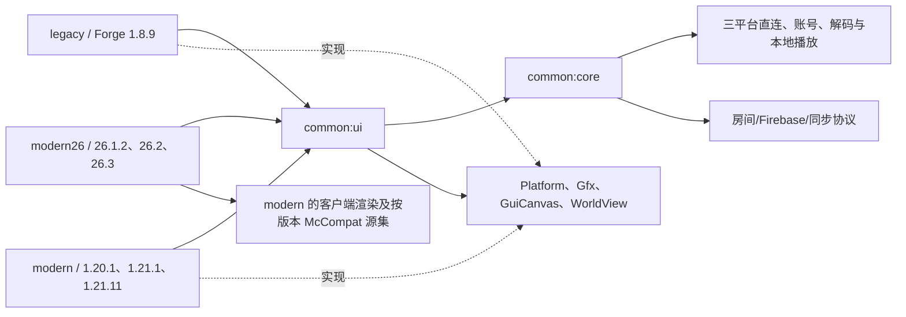

# DangoMusic GTNH Edition 源码审计

审计对象为 [DangoMusic v1.7.3](https://github.com/Sorihiko/DangoMusic/tree/1e82730e6cbf19301e33cc6901f210bcffe9ea2c)，提交 `1e82730e6cbf19301e33cc6901f210bcffe9ea2c`。以下为源码和本机现有日志的核对结果。平台账号、音频设备、着色器及联机均需在移植版实测。

## 工程与依赖

| 目录 | 构建与兼容性 |
|---|---|
| `common` | 独立 Gradle composite build。Kotlin 版本随调用方 Gradle 选择，core/ui 声明 JVM 8 目标。无直接 Minecraft/LWJGL import，移植时仍须编译并检查 JDK API、反射、网络和资源。 |
| `legacy` | ForgeGradle-Modern 2.1、Kotlin 2.0.21、Shadow 7.1.1，Forge **1.8.9-11.15.1.2318**，stable_22。可保留渲染算法。FML 包名、GUI 生命周期、矩阵、纹理和 GL 状态实现要适配 1.7.10。 |
| `modern` | Architectury Loom 1.13-SNAPSHOT，Kotlin 2.2.21，Fabric / Forge / NeoForge，Java 17 或 21。loader 入口、渲染适配、音频适配和每版本 McCompat 用于对照行为。 |
| `modern26` | Fabric Loom 1.18-SNAPSHOT 或 NeoForge ModDevGradle 2.0.148，Kotlin 2.3.21 / Java 25，复用 modern 的客户端及版本适配源码。新式渲染入口和 mappings 与 1.7.10 不兼容。 |
| `docs` | 版本记录、原始 UI 和歌词截图、logo、光影兼容说明。用于视觉回归和对照绘制时机。 |

## 功能与源码位置

Kotlin 路径以对应模块的 `src/main/kotlin/me/sorihiko/dango/` 为基准。各 loader 入口另在 Java 源集或 versions 子项目。

| 功能 | 源码与调用关系 | 移植处置 |
|---|---|---|
| 启动、快捷键、主菜单 | legacy `forge/DangoMusicMod.java` → `legacy/LegacyGl.kt`、`forge/ForgeBridge.kt`、`LegacyKeyBindings`、`LegacyPlatform` → `DangoClient.start` → `DangoMusic`、事件/模块注册。modern 则经 loader 入口进入 `ModernDango`。 | 重写 FML 入口和适配，保留模块启动语义。 |
| 播放器 UI | `music/MusicScreen` 组织 `musicui/Sidebar`、`GridPage`、`TracksPage`、`ArtistPage`、`LoginDialog`、`PlayerBar`、`SettingsPage`、`Library`；`ui/Theme`、`Layout`、`RenderContext` 定义样式、布局和绘制契约。 | 保留页面、布局、交互及动画。分离 PartyPage、路由和侧栏入口。 |
| 曲目/歌单/歌手/专辑 | `music/MusicSources` 中的 MusicSourceApi，`NeteaseTrack`、NeteasePlaylist、SourceArtist 用作共享模型。QQ/酷狗以来源加平台 ID 映射到内部标识，部分专辑复用歌单曲目入口。 | 保留解析与映射，在 Provider 边界明确曲目详情、专辑详情和错误语义。 |
| 网易云 | `NeteaseApi` 负责搜索、详情、歌单、推荐、排行、歌手及专辑；`NeteaseLogin` 发起扫码和轮询；`NeteasePlayback` → `NeteasePlayerRequest` 获取播放地址，区分试听与完整音源；`NeteaseLyrics` 解析歌词。主要直连 music.163.com / interface.music.163.com。 | 复用，验证匿名、授权、过期、试听和拒绝响应。 |
| QQ 音乐 | `QqMusicSource`、`QqCatalog`、`SourceArtists`、`QqCloud` 处理曲库；`NativeLogin` 与 `QqAppSession`、`QqAppChannel`、`QqRenewal` 管理扫码与续期；`QqPlayback` 使用 UrlGetVkey，并有旧接口兼容路径；`QqLyrics` 解包 QRC。主要直连 u.y.qq.com、c.y.qq.com 和登录域。 | 复用授权路径，逐项验证 App 会话、vkey、曲库及歌词。 |
| 酷狗 | `KugouMusicSource`、`KugouCatalog`、`KugouCloud`、`SourceArtists` 处理搜索/曲库；`NativeLogin`、`KugouLite`、`KugouWeb`、`KugouDevice` 处理账号和设备信息；`KugouPlayback`、`KugouGateway` 解出播放地址；`KugouLyrics` 处理 KRC。主要直连 gateway.kugou.com、msearchretry.kugou.com、lyrics.kugou.com。 | 分别核验登录、正式授权流、移动回退、试听和活动权益的服务端语义。 |
| 账号和传输 | `AuthHttp`、`SourceHttp`、`NativeAccount`。源码已有部分请求的超时和字节上限；账号有 provider 分区，会话文件包括 Cookie，使用后台任务刷新。扫码轮询和异步请求入口分散。 | 统一生命周期、取消、限流及错误分类。隔离账号目录，严禁日志输出带签名 URL 或 Cookie。 |
| 音频 | `MusicPlayer` 管理队列、generation、加载/解码、暂停、切歌、seek、增益和进度；`AudioDecoder` 分派 JLayer MP3、DangoVorbis/JOrbis Ogg Vorbis、FlacReader FLAC；`AudioOutput` 提供 Java Sound PCM。modern 另有 `GameAudioOutput`。 | 保留解码与 PCM 路径。拆除同步、审核取消/资源释放，并对网络和缓冲设上限。 |
| 歌词 | `lyrics/LyricsProvider` 解析 LRC/YRC、翻译配对和按时间索引；各平台歌词解析器转为 LyricLine/LyricWord；`LyricsModule` 根据播放进度渲染，`TextFlash` 实现闪现。 | 保留解析、字级时间及效果逻辑。重写世界渲染后端。 |
| HUD 和封面 | `SongCardModule`、`DynamicIslandModule` → `Gfx`，`CoverArt`、`CoverCache` 处理封面。 | 保留显示、缩放和位置配置。后台下载及解码，渲染线程维护纹理。 |
| 液态玻璃、世界字形 | legacy `LegacyGfx`、`GlassRenderContext`、`GlassBackdrop`、`DeepGlow`、`GlStateSnapshot`、`CjkFont`、`UiFont`；ModernGfx/Gl 仅对照行为。 | 复用样式、shader 和几何。替换 GlStateManager、屏幕尺寸、资源系统及 FBO 入口。检查绑定、矩阵、深度和 Angelica 绘制阶段。 |
| 配置与更新 | `ConfigManager` 与模块值系统持久化；`UpdateChecker` 引用 FirebaseConfig。 | 独立设置和账号目录。上游更新提示需与房间配置解绑，避免将上游 JAR 当作 GTNH 更新。 |
| 房间与同步 | `core/party`、`PartyPage`、loader PartyNetwork、MusicPlayer 内的 host/follow/request 分支、Firebase 规则和构建属性。 | 删掉实际网络、状态、UI 和配置链路，清除残留符号。保持正常平台请求及队列行为。 |

## 依赖和资源

| 依赖 | 版本、用途和分发要点 |
|---|---|
| Kotlin stdlib | legacy 2.0.21，modern 2.2.21，modern26 2.3.21。Apache-2.0。需要隔离运行库并处理通知文件。 |
| JLayer | 1.0.1，MP3。上游打包 LGPL-2.1 文本。 |
| JOrbis / Jogg | 0.0.17，Vorbis/Ogg。上游声明 LGPL-2.0-or-later，文件名是 LGPL-2.1，发布前核对各源文件及 DangoVorbis 封装。 |
| ZXing Core | 3.3.3，二维码，Apache-2.0。 |
| Gson、Log4j API | common 按 Gson 2.2.4、Log4j 2.0-beta9 编译，均为 Apache-2.0。目标用游戏解析出的版本，避免重复嵌入，须检查具体 API 签名。 |
| Java Sound、AWT、ImageIO | JDK 桌面模块提供 PCM 输出、字体与位图，无独立 mod 依赖。运行时要检查可用音频行与 CJK 字体。 |
| Forge、LWJGL、OpenAL、游戏渲染 API | 由宿主提供。Forge/FML 和底层库随目标发行包，编译期与运行期需分别验证。原项目 modern 各 loader/构建插件仅为对应分支构建或运行依赖。 |

共享资源有英文/中文 JSON、中文 TSV、四个裁剪 Inter 字体和 OFL 文本。legacy 有旧版 .lang、图标、版本元数据及玻璃、字体、形状、图片、Glow 的 GLSL；modern shader 与其分别按后端管理。源码树未见作为歌曲发布的音频资源，曲目、封面、二维码及歌词来自各平台。字体要保留作者信息，检查裁剪版命名、授权及系统 CJK fallback，保持新的资源命名空间。主仓库以 GPL-3.0 发布。发二进制前需随版本提供对应源码和必要的构建信息，逐库核对 LGPL 的替换、重新链接与源码提供条件，不能仅依赖现有 LICENSE 文本。

## 本机基线与风险

- ShatteredPrism 的 `290正式版` 实例中，现有游戏日志显示 GTNH 2.9.0、Minecraft 1.7.10、FML 7.99.40.1614、LWJGL 3.4.3+4 和声音引擎启动。实例组件为 Forge 10.13.4.1614、LWJGL 3.4.3、lwjgl3ify 3.0.42，安装 Angelica 2.2.43、GTNHLib 0.11.54、Custom Main Menu 1.14.1。启动器指定 Java 25.0.3，该路径的 JDK 可运行。具体 OpenAL 设备和驱动版本未测。
- 启动器组件补丁显示该实例解析 Gson 2.10.1、Log4j API/core 2.0-beta9-fixed、Paulscode soundsystem 20120107 和 LWJGL OpenAL 绑定及 Windows 本地包 3.4.3。绑定版本与运行时实际驱动/设备须分别检查。
- 三家接口为上游实现的服务端协议，源码存在并不证明当前可用。酷狗上游含活动权益逻辑，联网测试前逐条确认授权来源及失败行为。地区限制、二维码失效、试听、CDN 拒绝和账号过期都需要独立结果。当前没有已授权的账号会话，也没有供最终联机验收的服务器资料。
- Shader 在固定功能管线能编译只是前提。1.7.10 的 RenderWorldLastEvent 与 Angelica 合成的相对顺序、CJK 字形、分辨率变化和 GL 状态还原须实测。上游 `docs/shader-compatibility.md` 已明确 1.8.9 的入口和 modern 不同。
- 推荐保留 Kotlin Core/UI，建立 `me.sorihiko.dangomusicgtnh` 项目与独立 Forge 客户端桥。复用平台协议、模型、播放算法、UI 布局和旧版 shader，重写 Forge 生命周期、显示、输入、GL 状态和客户端隔离。技术决策和验证门槛见 PORTING_PLAN.md。

